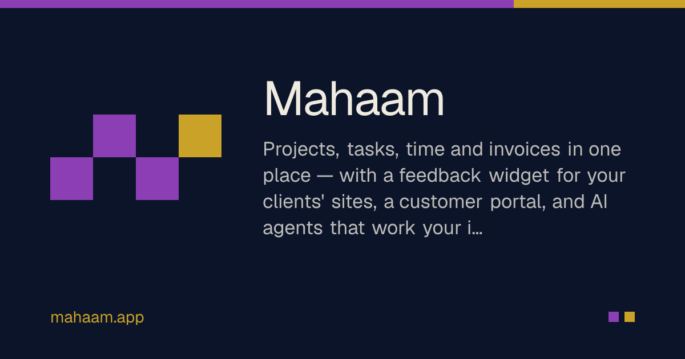
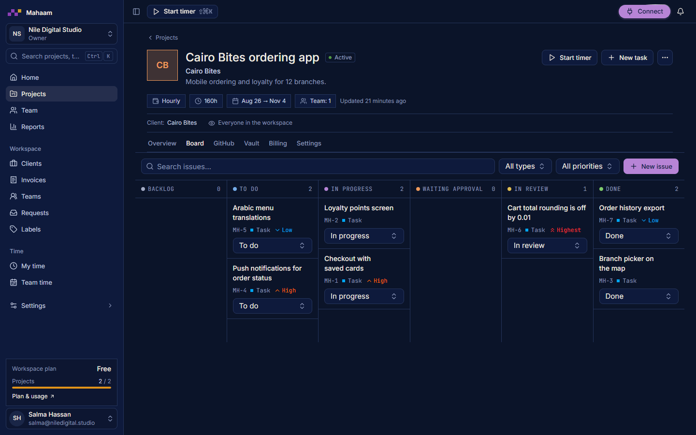
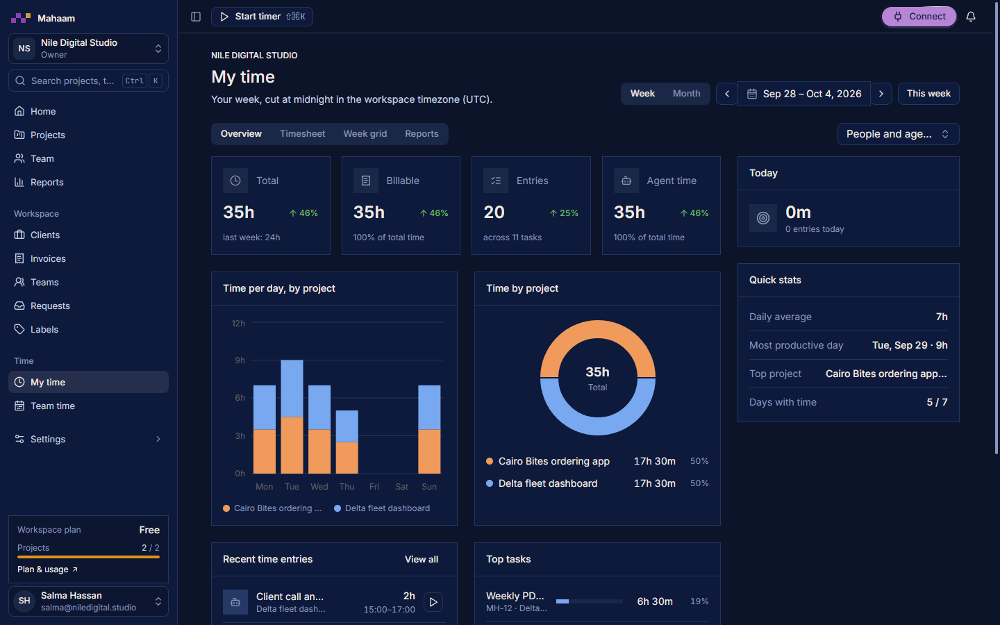
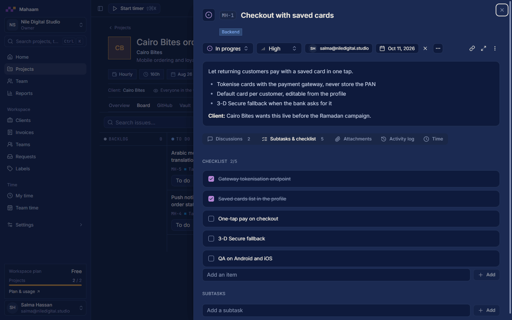

<div align="center">



# Mahaam — مهام

**Open-source project management for agencies and product teams: projects, issues, time tracking, invoices, a customer portal, and AI agents that work your board over MCP.**

[](https://to-go.dev)
[](https://github.com/togo-framework/togo)
[](https://github.com/fadymondy/mahaam/actions/workflows/ci.yml)
[](LICENSE)
[](https://discord.gg/a59RzxnB2H)
[](https://github.com/fadymondy/mahaam/stargazers)

[Website](https://mahaam.app) · [Open the app](https://console.mahaam.app) · [Architecture](docs/architecture.md) · [Discussions](https://github.com/fadymondy/mahaam/discussions) · [Discord](https://discord.gg/a59RzxnB2H)

</div>

<p align="center">
  
  
</p>

## Features

- **Projects and issues** — boards and lists, custom statuses, checklists, labels, comments,
  attachments and a full activity log. Clients, teams and per-project access.
- **Time tracking everywhere** — a timer on the web, the tray app, the Chrome extension and the
  mobile apps; timesheets, rates snapshotted per entry, budgets and profitability reports.
- **Invoices from time** — turn tracked time, AI usage and subscriptions into invoices; billing
  through Polar for the hosted plans.
- **Customer portal** — clients see their projects, accept or reopen issues, file requests and
  see their invoices without a staff seat.
- **Feedback SDK and widget** — drop `/embed/v1.js` into any site and bug reports (with
  screenshots and diagnostics) land on the right project's board.
- **AI agents over MCP** — scoped user tokens let Claude, Cursor, ChatGPT and friends read the
  board, start issues, log time and request review, under the same permission checks as a human.
  AI token usage and cost are tracked per issue.
- **Integrations** — GitHub, Jira and Linear sync, a per-project secrets vault, customer
  import and PDF/Markdown reports.
- **Multi-tenant by construction** — every tenant row carries `workspace_id`, enforced by Postgres
  row-level security and composite foreign keys, with a cross-workspace isolation sweep in CI.
- **Bilingual** — English and Arabic (RTL), light and dark.

<p align="center">
  
</p>

## Quick start

### Hosted

The fastest way to try Mahaam is the hosted version at **[mahaam.app](https://mahaam.app)**: sign up,
create a workspace and invite your team. A free plan is available.

### Self-host with Docker Compose

Requirements: Docker with Compose v2.

```bash
git clone https://github.com/fadymondy/mahaam.git && cd mahaam
cp .env.selfhost.example .env.selfhost
# fill in POSTGRES_PASSWORD, MAHAAM_APP_DB_PASSWORD, AUTH_SECRET, MAHAAM_SECRET_KEY
# (generate each with: openssl rand -base64 32)
docker compose -f docker-compose.selfhost.yml --env-file .env.selfhost up -d --build
```

Open http://localhost:3010, register, and create a workspace. The stack is Postgres 16, a one-shot
migration job, the Go API and the Next.js web app. For a public deployment put a TLS reverse proxy
in front, set `APP_URL` to the public origin and `COOKIE_SECURE=1`. Every other setting (mail,
OAuth integrations, push, billing) is documented in [`.env.example`](.env.example).

Make the first user a platform admin:

```bash
docker compose -f docker-compose.selfhost.yml --env-file .env.selfhost exec api /app/mahaam-admin promote you@example.com
```

### Local development

See [CONTRIBUTING.md](CONTRIBUTING.md#local-setup). In short: `make db migrate api` and `make web`.

## Architecture

```
            ┌──────────────┐  ┌───────────────┐  ┌─────────────┐  ┌──────────────┐
 clients →  │  Web (Next)  │  │ Tray / Chrome │  │ Mobile Expo │  │ MCP clients  │
            └──────┬───────┘  └───────┬───────┘  └──────┬──────┘  └──────┬───────┘
                   │  /api, /graphql, /embed (proxied)  │                │ /api/mcp
            ┌──────▼────────────────────────────────────▼────────────────▼───────┐
            │ Go API (ToGO: chi + Huma REST + gqlgen + sqlc)                       │
            │  default-deny guard → internal/work (one domain layer for REST+MCP)  │
            │  live SSE · scheduler · mail · billing · integrations · secretbox    │
            └──────┬───────────────────────────────────────────────────────────────┘
                   │ owner pool (migrations, auth)   app pool (RLS, app.workspace_id)
            ┌──────▼──────────────────────────────────────────────┐
            │ PostgreSQL 16 — row-level security on every tenant table │
            └─────────────────────────────────────────────────────┘
```

| Path | What |
|---|---|
| `cmd/api`, `cmd/migrate`, `cmd/mahaam-admin` | API server, migrations (schema, app role, RLS), platform admin CLI |
| `internal/work` | The domain layer: REST routes under `/api/w/*` and MCP tools call the same functions |
| `internal/db/schema`, `internal/db/post` | Hand-written Postgres schema, constraints and RLS policies |
| `internal/mcp` | User and admin MCP servers |
| `web/` | Next.js 16 app (en/ar), UI from [Nasaq](https://github.com/fadymondy/nasaq) |
| `apps/` | Electron tray app, desktop app, Chrome extension, Expo mobile apps |
| `embed/` | The embeddable feedback widget (`/embed/v1.js`) |

The full engineering notebook — tenancy, RLS, time-tracking invariants, MCP scopes and the framework notes — is in **[docs/architecture.md](docs/architecture.md)**.

### Built on ToGO

Mahaam is built on **[ToGO](https://to-go.dev)** ([GitHub](https://github.com/togo-framework/togo)), the
open-source, API-first framework for Go + sqlc + Atlas + GraphQL/OpenAPI + Next.js with a
Laravel-style CLI. The kernel is small and everything else is a plugin; these are the pieces
Mahaam uses ([read the case study](https://to-go.dev/en/blog/mahaam-togo-case-study)):

| ToGO piece | What it does in Mahaam |
|---|---|
| [Kernel](https://github.com/togo-framework/togo) | Config, the hook/event bus, the plugin registry and server bootstrap |
| [CLI](https://github.com/togo-framework/cli) | `togo generate` (sqlc → gqlgen → Atlas → OpenAPI), migrations, `togo serve` |
| [auth](https://github.com/togo-framework/auth) | Sign-in, JWT sessions, roles and API tokens |
| [auth-oauth](https://github.com/togo-framework/auth-oauth) | Social sign-in |
| [orm](https://github.com/togo-framework/orm) | Query building in the domain services |
| [validation](https://github.com/togo-framework/validation) | Laravel-style request validation |
| [ratelimit](https://github.com/togo-framework/ratelimit) | Throttling for the API and MCP endpoints |
| [mail](https://github.com/togo-framework/mail) | Transactional email |
| [import-export](https://github.com/togo-framework/import-export) | CSV and Excel import and export |
| [scheduler](https://github.com/togo-framework/scheduler) | Recurring jobs over the queue |
| [queue · cache · storage · realtime · i18n](https://github.com/togo-framework) | Background work, caching, file uploads, live updates and EN/AR |
| [db-postgres](https://github.com/togo-framework/db-postgres) | The Postgres driver |
| [faker](https://github.com/togo-framework/faker) | Factories and seed data for tests |

Want the same foundation for your own app? Run `go install github.com/togo-framework/cli@latest && togo new myapp`,
then read the [ToGO docs](https://to-go.dev/en/docs) and browse the [plugin marketplace](https://to-go.dev/marketplace).

## Documentation

- [Architecture and engineering notes](docs/architecture.md)
- [Mobile SDK contract](docs/mobile-sdk-contract.md) · [Mobile crash capture](docs/mobile-crash-capture.md)
- [Analytics taxonomy](docs/analytics-taxonomy.md) · [Site tracking extension](docs/extension-site-tracking.md)
- [CircleXO integration](docs/circlexo.md)
- API reference: run the API and open `/docs` (OpenAPI) or `/graphql`

## Contributing

Contributions are welcome — bug reports, docs, and code. Read [CONTRIBUTING.md](CONTRIBUTING.md)
for setup, conventions and the DCO sign-off, then look for
[`good first issue`](https://github.com/fadymondy/mahaam/labels/good%20first%20issue). AI coding
agents should start with [AGENTS.md](AGENTS.md).

## Community

- [Discord](https://discord.gg/a59RzxnB2H) — chat with the team and other users
- [GitHub Discussions](https://github.com/fadymondy/mahaam/discussions) — questions, ideas, show and tell
- [Issues](https://github.com/fadymondy/mahaam/issues/new/choose) — bugs and feature requests
- Security reports: see [SECURITY.md](SECURITY.md)

Please follow the [Code of Conduct](CODE_OF_CONDUCT.md).

## Sponsor

Mahaam is built on **[ToGO](https://github.com/togo-framework/togo)**, the open-source Go + React
framework that powers this whole family of apps. The best way to support Mahaam is to **sponsor ToGO**:
every sponsorship goes into the framework and the apps built on it.

**[Sponsor ToGO →](https://to-go.dev/sponsor)**

Or back Mahaam directly on Open Collective: **[opencollective.com/mahaam →](https://opencollective.com/mahaam)**

<p>
  <a href="https://to-go.dev/sponsor"></a>
  <a href="https://github.com/sponsors/fadymondy"></a>
  <a href="https://buymeacoffee.com/fadymondy"></a>
</p>

## License

Copyright (C) 2026 Fady Mondy. Mahaam is free software licensed under the
[GNU Affero General Public License v3.0](LICENSE). If you run a modified version as a network
service, you must offer its source to your users. Third-party components keep their own licenses.

**Commercial licensing available:** for a license without the AGPL obligations, contact
[info@3x1.io](mailto:info@3x1.io).
